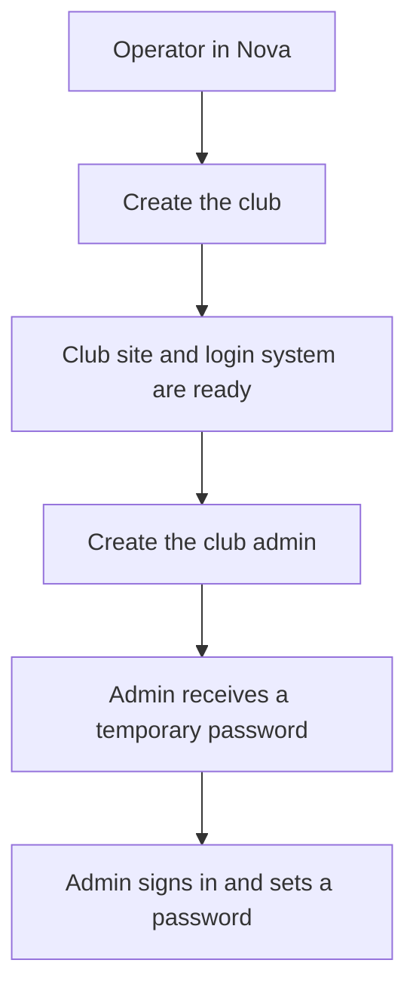
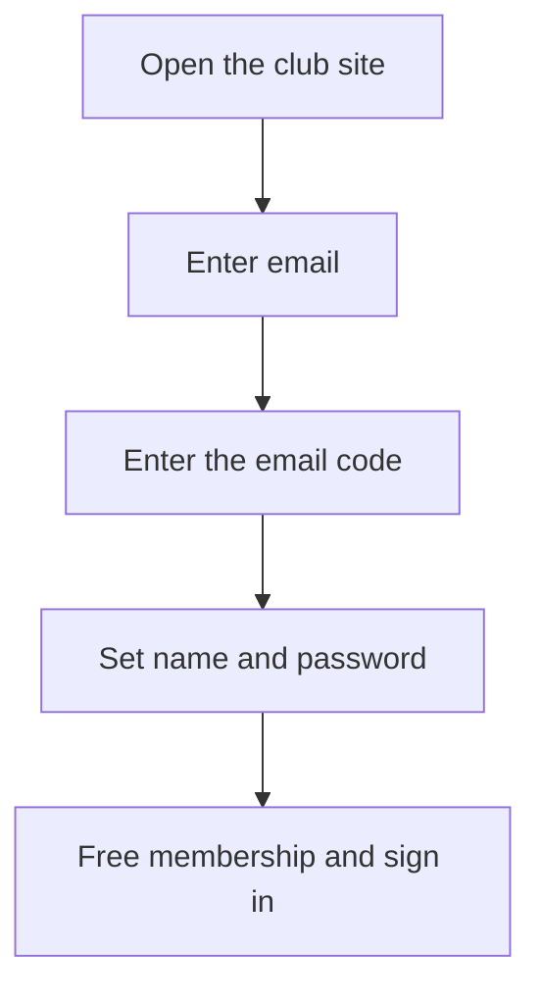
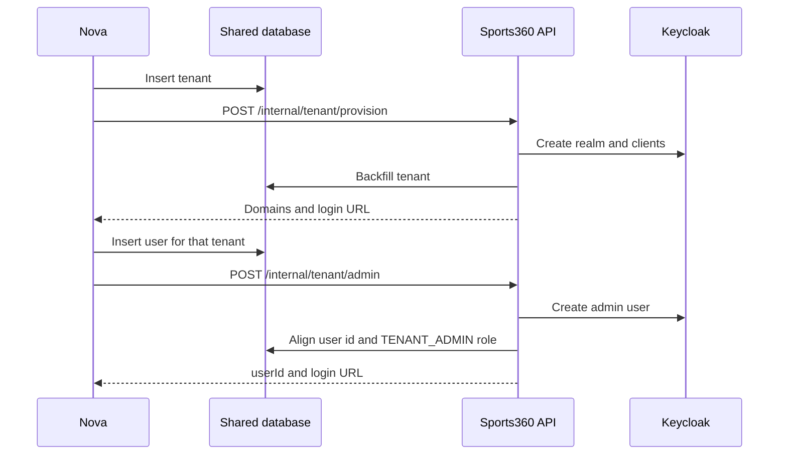
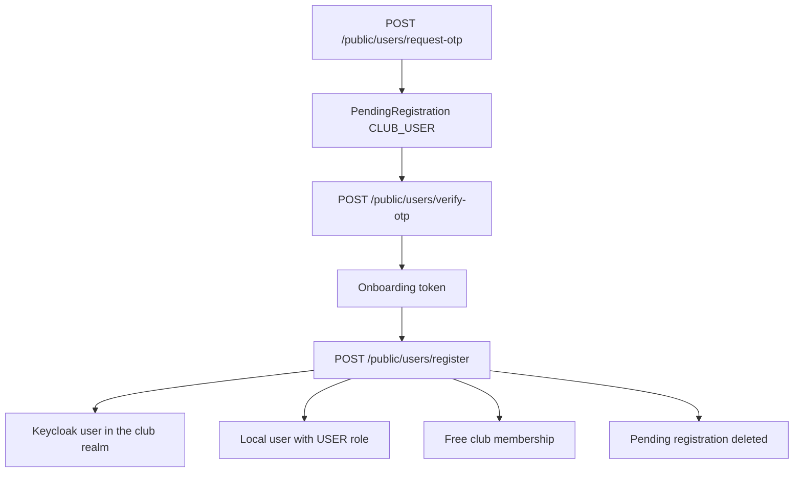

# Business and user onboarding

[⬅️ Back to Index](../README.md)

Clubs are created by a Sport360 operator in the Nova panel. Fans sign themselves up on a club that already exists. This page describes both journeys in plain language, then the internal architecture of each.

Fan API examples live in the [Fan Registration guide](../fan-registration/index.md). Login lives in the [Authentication guide](../authentication-guide/index.md).

---

## How onboarding works

### Clubs

A club does not sign itself up on the public site. An operator in the Nova panel does it in two steps.

1. **Create the club.** The operator enters the club (name, team, plan, and branding). Nova saves the club, then asks the backend to finish setup. The club receives its own login system, a public site address, and an admin site address.
2. **Create the club admin.** The operator opens that club and adds the person who will run it. Nova saves that person, then asks the backend to create their login. The admin receives a temporary password by email and signs in on the club admin site, where they set their own password.

Until both steps finish, fans have no club site to join and the admin has no login.

### Fans

A fan joins a club that is already live. They open that club’s site, confirm their email with a one-time code, then choose a first name, last name, and password. They receive a free membership and can sign in.

A paid membership is a later purchase. It is not part of creating the account.

---

## Internal architecture — clubs

Club onboarding is operator-driven. Nova owns validation and the first database write. The backend owns Keycloak, DNS, and filling in the rest of the row. The two calls are separate: creating a club does not create an admin.

Both calls are server-to-server. They use the `X-API-SECRET` header (`InternalApiFilter`), not a user login token. The controller is `NovaPanelClubOnboardingController`. The service is `NovaPanelClubOnboardingService`.

### Create the club

Nova validates the team, plan, and uniqueness, then inserts a `tenant` row. The row needs an id, a name, and a non-empty placeholder domain. Team, plan, and branding can be set on that insert. The club exists in the database before the backend is called.

Nova then calls:

`POST /api/v1/sports360/internal/tenant/provision`

Body: `{ "tenantId": "<uuid>" }`

`NovaPanelClubOnboardingService.provisionTenant` loads that tenant and refuses the call when `realm_name` is already set. `InternalKcRealmProvisioner.provisionRealm` builds the realm from the club name:

- Realm name is a slug of the club name. A short numeric suffix is added when that realm name is already taken.
- Public domain is `{slug}.{systemDomain}`, or `{slug}-dev.{systemDomain}` in dev.
- Admin domain is `{slug}-admin.{systemDomain}`, or `{slug}-admin-dev.{systemDomain}` in dev.
- Keycloak clients: `{slug}-web-client`, `backend-service-{slug}`, `{slug}-mobile-client`, `{slug}-admin-web-client`.
- The web, mobile, and admin clients receive a `tenant_id` claim set to the tenant UUID Nova already stored.
- Realm helpers are shared with `KeycloakProvisioningService` (realm, clients, mappers). This step creates no users.

After Keycloak succeeds, Cloudflare DNS CNAMEs for the public and admin hostnames are created in the same request. A DNS failure fails the call (`error.dns_provisioning_failed`). There is no automatic retry.

The backend then writes the tenant back:

| Field | What is stored |
| --- | --- |
| `realm_name`, `issuer_uri` | Keycloak realm |
| `domain`, `admin_domain` | Public and admin hostnames (placeholder domain is replaced) |
| Client ids | Web, service, mobile, and admin panel clients |
| Client secrets | Encrypted at rest |
| `cf_admin_record_id`, `cf_user_record_id` | Cloudflare record ids |
| `active` | Set to true |

`LanguageService.ensureDefaults` adds the club’s default languages. Secrets are not returned to Nova. The response carries the tenant id, realm, domains, and the admin login URL.

### Create the club admin

The operator finds the club in Nova and creates the admin. Nova inserts a `user` row linked to that tenant (id, email, name, and usually phone), then calls:

`POST /api/v1/sports360/internal/tenant/admin`

Body: `{ "tenantId": "<uuid>", "userId": "<uuid>" }`

`provisionAdmin` requires the tenant to already have a realm and a service client. The user row must belong to that tenant and must not already have a Keycloak id.

`KcUserManagementService.createUser` creates the Keycloak user in the club realm with a temporary password. The database user id must equal the Keycloak user id, because that id is the JWT `sub`. When Nova’s id differs, the backend rewrites the row and returns both `previousUserId` and `userId` so Nova can update its references. The user is assigned the system role `TENANT_ADMIN`.

Side effects run after the user exists. Email failure, ShotMob sync, and ticketing registration are logged and do not undo the Keycloak user:

- Temporary-password email and welcome email (`OnboardingEmailService`)
- ShotMob team sync when the tenant has a `team_id`
- TktatIQ club-admin registration (`TicketingService.onboardClubAdmin`)

The temporary password is emailed. It is not included in the API response. The admin signs in at `https://{adminDomain}`.

---

## Internal architecture — users

Fans are the only self-serve registration. The club realm, service client, and active tenant must already exist from the Nova club step. The fan does not create a tenant.

`FanRegistrationController` resolves the club with `TenantResolverService` (`X-Tenant-ID`, otherwise the club subdomain) and delegates to `FanRegistrationService`.

### Email code

`POST /api/v1/sports360/public/users/request-otp`

The tenant must be active. If that email already exists in the club’s Keycloak realm, the call is rejected. Otherwise the service upserts a `pending_registration` row:

| Field | Value |
| --- | --- |
| `type` | `CLUB_USER` |
| `status` | `PENDING_OTP` |
| `payment_status` | `PAID` (signup has no charge) |
| `tenant_id` | The club being joined |
| `expires_at` | 7 days from the latest request |

A 6-digit code is hashed and emailed. It expires after 10 minutes. Requesting the code again for the same email and club refreshes the hash and expiry.

`POST /api/v1/sports360/public/users/verify-otp`

A valid code marks the row verified, clears the hash, and returns an onboarding token. `OnboardingTokenService` issues that token for 24 hours with purpose `user_registration`. The register call sends it as `Authorization: Bearer`. `OnboardingTokenFilter` accepts it on the register path and sets the authenticated email. The email in the token is the one that is registered. It is not taken from the body.

### Create the account

`POST /api/v1/sports360/public/users/register`

Body: `firstName`, `lastName`, `password`.

The pending row must exist for this email and club and must be OTP-verified. The service then:

1. Creates the Keycloak user in the club realm through the tenant service client, using the password the fan chose.
2. Saves a local `UserEntity` whose id is the Keycloak user id, with system role `USER` (`LOGIN_USER_PORTAL`). Authorization for fans is stored in the database. No Keycloak realm role is assigned.
3. Assigns the free club membership via `FreeMembershipAssignmentService.assignIfAbsent`.
4. Deletes the `pending_registration` row.

Unfinished rows in `PENDING_OTP` are removed by `OnboardingCleanupScheduler` after `expires_at`.

After registration the fan signs in with the existing Authorization Code and PKCE flow: `GET /api/v1/sports360/auth/init`, then `POST /api/v1/sports360/auth/token`. Profile fields such as phone and photo are updated later through `/api/v1/sports360/user/profile`.
